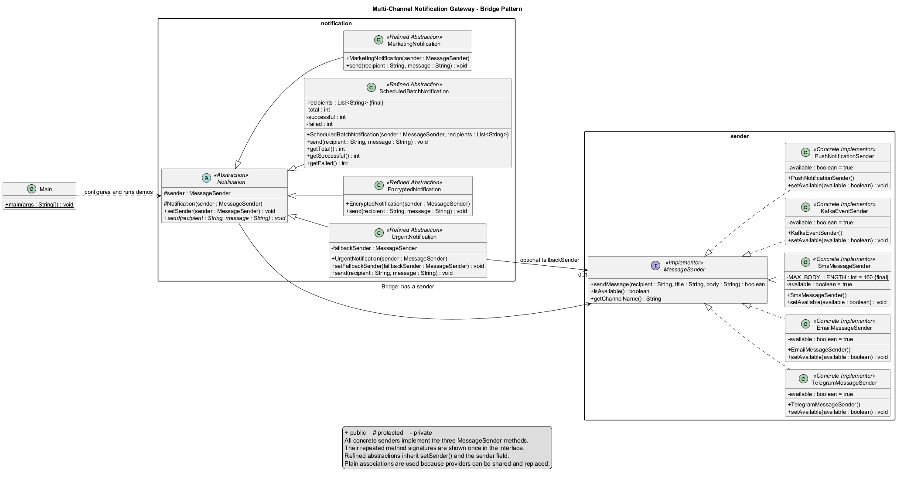

# Multi-Channel Notification Gateway

Software Design Patterns Assignment 3 demonstrates the **Bridge Pattern** in a Java console application. Notification types control message preparation, while providers control delivery. All delivery is simulated with console output; no external messaging services are called.

## Technologies

- Java 17
- Maven
- JUnit 5.14.3 and Maven Surefire 3.5.5
- PlantUML for the class diagram

## How the Bridge works

The project separates two independent dimensions:

| Dimension | Classes |
| --- | --- |
| Notification types | `UrgentNotification`, `EncryptedNotification`, `ScheduledBatchNotification`, `MarketingNotification` |
| Delivery providers | `TelegramMessageSender`, `EmailMessageSender`, `SmsMessageSender`, `KafkaEventSender`, `PushNotificationSender` |

`Notification` is the abstract base class. It holds `protected MessageSender sender`, receives it through its protected constructor, and provides `setSender(MessageSender)` for replacement. Each subclass implements `send(String recipient, String message)` and delegates delivery through the interface.

`MessageSender` is the delivery interface with exactly three methods:

```java
boolean sendMessage(String recipient, String title, String body);
boolean isAvailable();
String getChannelName();
```

All five providers start available and have `setAvailable(boolean)`. Unavailable providers return `false`. Telegram formats the title, Email adds a signature, SMS rejects bodies longer than 160 characters without truncating, Kafka simulates publishing to the `notifications` topic, and Push simulates delivery to a device.

The notification classes depend only on `MessageSender`. They do not use concrete provider types or `instanceof` checks. `Main` chooses the actual combinations.

## Project structure

```text
Assignment3_Bridge/
├── pom.xml
├── README.md
├── docs/
│   ├── bridge.puml
│   └── bridge.png
└── src/
    ├── main/java/
    │   ├── Main.java
    │   ├── notification/
    │   │   ├── Notification.java
    │   │   ├── UrgentNotification.java
    │   │   ├── EncryptedNotification.java
    │   │   ├── ScheduledBatchNotification.java
    │   │   ├── MarketingNotification.java
    │   │   └── package-info.java
    │   └── sender/
    │       ├── MessageSender.java
    │       ├── TelegramMessageSender.java
    │       ├── EmailMessageSender.java
    │       ├── SmsMessageSender.java
    │       ├── KafkaEventSender.java
    │       ├── PushNotificationSender.java
    │       └── package-info.java
    └── test/java/
        ├── notification/NotificationTest.java
        ├── sender/MessageSenderTest.java
        └── testsupport/
            ├── RecordingMessageSender.java
            └── ConsoleTestSupport.java
```

## Run in IntelliJ IDEA

1. Open the existing project and load `pom.xml` as a Maven project if prompted.
2. Set the Project SDK and Maven runner JRE to Java 17.
3. Open `src/main/java/Main.java`.
4. Click the green run icon beside `main` and choose **Run 'Main.main()'**.
5. Read the six numbered scenarios in the Run console.

With Maven and Java 17 on PATH, the same demo can be run from the project root:

```shell
mvn clean verify
java -cp target/classes Main
```

## Tests

Run the JUnit 5 tests from the project root:

```shell
mvn clean test
```

For tests and JAR packaging together, run `mvn clean verify`. If Maven is not on PATH, use IntelliJ's Maven tool window to run these lifecycle goals with Java 17.

The suite contains 6 provider tests and 11 notification tests. The recording sender captures recipients, titles, bodies, call counts, and delivery results. Some tests wrap real providers; others use configured fake results. Console capture checks output and is restored after each test.

Verified results for this documentation step:

```text
Tests run: 17, Failures: 0, Errors: 0, Skipped: 0
BUILD SUCCESS
```

## Six mandatory demonstrations

| No. | Scenario | What the console shows |
| --- | --- | --- |
| 1 | Urgent + Telegram | `[URGENT]` is added and Telegram delivers the message. |
| 2 | Encrypted + Email | `Hello, student!` becomes `SGVsbG8sIHN0dWRlbnQh` and is sent as the email body. |
| 3 | Scheduled Batch + SMS | Five stored phone numbers receive a short message. The calculated summary is `Total: 5`, `Successful: 5`, `Failed: 0`. |
| 4 | Runtime switching | One `UrgentNotification` sends through Telegram, then the same object sends through Email after `setSender(email)`. |
| 5 | Telegram unavailable -> SMS fallback | Telegram is set unavailable. The urgent notification skips primary sending and delivers through SMS. |
| 6 | Marketing + Push | `[PROMO]` is added and Push delivers the promotional message to a sample device. |

Despite its name, `EncryptedNotification` uses UTF-8 Base64 **encoding**, which is reversible and is not secure encryption. `ScheduledBatchNotification` sends immediately when `send()` is called; it does not implement a timer. It copies the recipient list in its constructor and ignores the single recipient argument. Before each batch it resets counters, checks availability for each recipient, and counts delivery results. Unavailable deliveries count as failures.

## Runtime switching and fallback

Runtime switching replaces the provider reference without creating another notification object:

```java
UrgentNotification notification = new UrgentNotification(telegram);
notification.send("@student", "First message");
notification.setSender(email);
notification.send("student@example.com", "Second message");
```

Fallback is configured separately on `UrgentNotification`:

```java
telegram.setAvailable(false);
UrgentNotification notification = new UrgentNotification(telegram);
notification.setFallbackSender(sms);
notification.send("+77001234567", "Submit now.");
```

Urgent delivery checks primary availability first. If the primary is unavailable or returns `false`, it tries the fallback only if configured and available. A successful primary delivery returns immediately, so fallback does not duplicate it. If neither delivers, a clear failure is printed. The current implementation supports one fallback provider.

## Independent extension

`PushNotificationSender` adds a provider by implementing the existing interface. Existing notifications can use it without changes. `MarketingNotification` adds a notification type by extending `Notification` and using only `MessageSender`. It adds `[PROMO]`, uses the title `Marketing Notification`, checks availability, and reports failed delivery.

The current demo combines Marketing with Push. JUnit tests also verify Marketing with the existing Email provider. Urgent can use Push through the same constructor, demonstrating that adding either dimension does not require a class for every combination.

## UML diagram

The [PlantUML source](docs/bridge.puml) shows the Bridge roles, fields, constructors, inheritance, interface implementation, and provider associations. It also includes the `Main` entry point. Repeated provider method signatures appear once in `MessageSender` to keep the diagram readable; each concrete provider implements all three.



To regenerate the PNG with a local PlantUML JAR:

```shell
java -jar /path/to/plantuml.jar -tpng docs/bridge.puml
```

Replace the JAR path with your own. The diagram selects PlantUML's [Smetana layout engine](https://plantuml.com/smetana02), which can render without an external Graphviz installation. PlantUML is a documentation tool and is not a Maven project dependency.

## Assignment questions

**Q1. What are the two independent dimensions?**

Notification behavior and message delivery providers. For example, urgent behavior can be combined with Telegram, Email, SMS, Kafka, or Push.

**Q2. Where exactly is the Bridge?**

The Bridge is the `MessageSender sender` field in `Notification`. Constructor injection and `setSender()` connect a notification to a provider through the interface. Notification subclasses call that provider's methods to deliver their prepared messages.

**Q3. Why is inheritance problematic here?**

Using a separate subclass for each combination, such as `UrgentTelegramNotification`, would multiply classes as both dimensions grow and repeat delivery logic. Java also does not allow extending two classes. Composition lets notification behavior and provider behavior stay separate.

**Q4. What happens when a new provider is added?**

Create a class implementing `MessageSender` and pass it to existing notifications. The interface and notification classes stay unchanged. Client code selects the new provider and tests verify it.

**Q5. What happens when a new Notification type is added?**

Extend `Notification`, accept a `MessageSender` in the constructor, and implement `send()`. Existing providers can deliver its messages without changes.

**Q6. Why is this Bridge rather than Adapter?**

Bridge deliberately separates two dimensions that need to vary independently. Adapter makes an existing incompatible interface usable through another interface. Here, all providers already implement the same contract; the central purpose is independent extension and interchangeable combinations.

## Defense preparation: proposed changes only

These are explanations of possible changes; none is implemented in this step.

- **Add WhatsAppMessageSender:** create a class implementing the three `MessageSender` methods. Give it availability state and a setter like the other providers, then pass it to an existing notification.
- **Change the SMS limit to 120:** change `MAX_BODY_LENGTH` in `SmsMessageSender` to `120` and update its hardcoded error text. Update the SMS boundary tests from 160/161 to 120/121. The notification classes do not need changes.
- **Add SilentNotification:** extend `Notification`, accept `MessageSender`, and implement `send()`. For a simple silent variant, delegate without extra notification logging. Providers still print their own output; fully silent delivery would also need a provider that does not print. A device-level silent option is not part of the current interface.
- **Make Email unavailable and use another provider:** call `email.setAvailable(false)`. For automatic fallback, use an `UrgentNotification` with Email as primary and an available sender such as SMS as fallback. Other notification types do not have automatic fallback; replace their sender with `setSender()`.
- **Add another fallback provider:** `setFallbackSender()` can replace the current fallback with any `MessageSender`. Supporting a second fallback in sequence would require extending urgent fallback logic, for example with a list of interface references. Check each provider's availability and stop after the first successful delivery.
- **Switch MessageSender at runtime:** call `setSender(newProvider)` on the same notification object before its next `send()` call. Use a recipient suitable for that provider, such as an email address or phone number.
